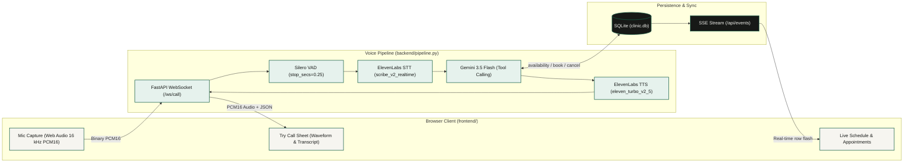
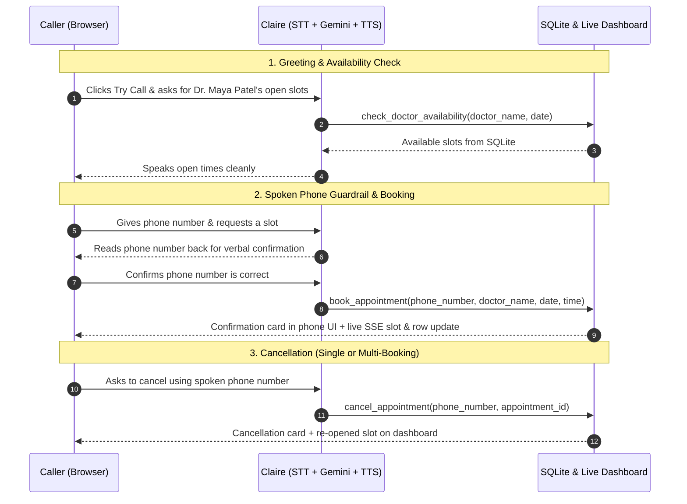

<div align="center">

# Alderbrook Clinic — Voice Appointment Desk

**A real-time AI clinic receptionist (_Claire_) paired with a live reception dashboard.**  
Callers speak naturally from the browser—identified strictly by their spoken phone number—to check doctor availability, book slots, and cancel appointments with live dashboard updates.

[](https://www.python.org/)
[](https://github.com/pipecat-ai/pipecat)
[](https://ai.google.dev/)
[](https://elevenlabs.io/)
[](https://fastapi.tiangolo.com/)

[Architecture](#architecture) • [Call Workflow](#call-workflow) • [Tech Stack](#tech-stack) • [Tools & API](#tools--api) • [Clone & Setup](#clone--setup-guide) • [Tests](#tests)

</div>

---

## Architecture



### How It Works Under the Hood
1. **Browser Audio Bridge (`frontend/audio.js`)**: Captures microphone input at the device's native sample rate, linearly resamples to **16 kHz mono PCM16**, and streams binary chunks over `/ws/call`. Incoming TTS chunks play cleanly on the native `AudioContext` while feeding a live 28-bin frequency waveform.
2. **Real-Time Turn Detection & STT (`backend/pipeline.py`)**: `SileroVADAnalyzer` (`stop_secs=0.25`) inside `LLMUserAggregatorParams` handles speech segmentation and caller barge-in interruptions, triggering manual commits on `ElevenLabsRealtimeSTTService` (`scribe_v2_realtime`) with clinic `keyterms` and background noise filtering.
3. **LLM & Guardrails (`backend/pipeline.py`, `backend/tools.py`)**: **Google Gemini (`gemini-3.5-flash`)** processes conversation turns with `retry_on_timeout=True`. Claire never relies on login or OTP—she verifies open slots live, reads back the caller's phone number for verbal confirmation, and then executes the booking or cancellation tool.
4. **Live Sync (`backend/server.py`)**: Every confirmed booking or cancellation broadcasts `appointment_booked` or `appointment_cancelled` to both the in-call phone card and all connected dashboard tabs via Server-Sent Events (`/api/events`).

---

## Call Workflow



---

## Tech Stack

| Layer | Technology | Model / Configuration | Source |
|---|---|---|---|
| **Voice Framework** | Pipecat (`pipecat-ai`) | `1.17.0+`, `FastAPIWebsocketTransport`, `BrowserAudioSerializer` | [`backend/pipeline.py`](backend/pipeline.py) |
| **Speech-to-Text** | ElevenLabs Realtime STT | `scribe_v2_realtime`, `CommitStrategy.MANUAL`, clinic `keyterms` | [`backend/pipeline.py`](backend/pipeline.py) |
| **LLM** | **Google Gemini** | **`gemini-3.5-flash`** (function calling + timeout retry) | [`backend/config.py`](backend/config.py) |
| **Text-to-Speech** | ElevenLabs TTS | `eleven_turbo_v2_5` (`EXAVITQu4vr4xnSDxMaL`, speaker boost) | [`backend/pipeline.py`](backend/pipeline.py) |
| **Turn Detection** | Silero VAD | `VADParams(stop_secs=0.25)` + barge-in interruptions | [`backend/pipeline.py`](backend/pipeline.py) |
| **API & Database** | FastAPI, Uvicorn, SQLite | REST, WebSocket, SSE broadcast queue, `clinic.db` | [`backend/server.py`](backend/server.py) |
| **Frontend** | Vanilla HTML, CSS, JS | Warm-stone minimal dashboard, Web Audio, Canvas waveform | [`frontend/app.js`](frontend/app.js) |

---

## Tools & API

### Registered Voice Tools (`backend/tools.py`)

| Tool | Parameters | Behavior |
|---|---|---|
| **`check_doctor_availability`** | `doctor_name`, `specialty`, `date` | Queries unbooked future slots from SQLite (handles `Dr.` / partial names) |
| **`book_appointment`** | `phone_number`, `doctor_name`, `date`, `time`, `patient_name` | Normalizes phone & time (`9:00 am` / `14:30`), blocks double-booking, emits SSE |
| **`cancel_appointment`** | `phone_number`, `appointment_id` | Cancels by spoken phone number; prompts for ID if multiple bookings exist |

### HTTP, SSE & WebSocket Endpoints (`backend/server.py`)

| Method & Path | Description |
|---|---|
| `GET /` | Serves the reception desk dashboard (`frontend/index.html`) |
| `GET /api/health` | Health check returning `{"status": "ok", "keys_configured": true\|false}` |
| `GET /api/dashboard` | Returns doctors with upcoming slots and active/cancelled appointments |
| `GET /api/events` | Server-Sent Events stream pushing `appointment_booked` & `appointment_cancelled` |
| `WS /ws/call` | Bidirectional 16 kHz PCM16 audio + JSON transcript/confirmation stream |

### Seeded Clinic Schedule (`backend/database.py`)

| Doctor | Specialty | Room |
|---|---|---|
| **Dr. Maya Patel** | Family Medicine | Suite 204 |
| **Dr. Samuel Okafor** | Cardiology | Suite 310 |
| **Dr. Hannah Lin** | Dermatology | Suite 118 |
| **Dr. Carlos Garcia** | Orthopedics | Suite 402 |

---

## Clone & Setup Guide

### 1. Clone the Repository

```bash
git clone https://github.com/26Utkarsh/Alderbrook-AI-Reception.git
cd Alderbrook-AI-Reception
```

### 2. Create a Virtual Environment & Install Dependencies

| Platform | Commands |
|---|---|
| **Windows (PowerShell)** | `python -m venv .venv`<br>`.\.venv\Scripts\Activate.ps1`<br>`pip install -r requirements.txt` |
| **macOS / Linux** | `python3 -m venv .venv`<br>`source .venv/bin/activate`<br>`pip install -r requirements.txt` |

### 3. Configure Environment Variables

Copy the template and add your API keys (`.env` is gitignored and must never be committed):

```bash
cp .env.example .env
```

| Variable | Required | Default | Description |
|---|---|---|---|
| `ELEVENLABS_API_KEY` | **Yes** | — | ElevenLabs key with STT & TTS access |
| `GOOGLE_API_KEY` | **Yes** | — | Google Gemini API key |
| `GEMINI_MODEL` | No | `gemini-3.5-flash` | Gemini model used by `GoogleLLMService` |
| `ELEVENLABS_VOICE_ID` | No | `EXAVITQu4vr4xnSDxMaL` | ElevenLabs voice ID for Claire (free-tier compatible) |
| `DB_PATH` | No | `clinic.db` | SQLite database file path |
| `HOST` / `PORT` | No | `0.0.0.0` / `8000` | Uvicorn server host and port |

### 4. Start the Server

```bash
python run.py
```

Open **`http://localhost:8000`**, allow microphone access, and click **Try Call** to speak with Claire.

---

## Tests

Unit tests in [`tests/test_appointments.py`](tests/test_appointments.py) validate phone/doctor/time normalization, availability filtering, double-booking prevention, multi-appointment cancellation disambiguation, and slot release:

```bash
pytest -v
```

---

<details>
<summary><strong>Project Structure</strong> (click to expand)</summary>

```text
Alderbrook-AI-Reception/
├── backend/
│   ├── __init__.py
│   ├── config.py          # Environment config dataclass
│   ├── database.py        # SQLite schema, seeding, normalization, CRUD
│   ├── pipeline.py        # Pipecat pipeline, Silero VAD, ElevenLabs STT/TTS, Gemini LLM
│   ├── serializer.py      # Binary PCM16 / JSON WebSocket frame serializer
│   ├── server.py          # FastAPI app, REST, SSE (/api/events), WebSocket (/ws/call)
│   └── tools.py           # Pipecat tool handlers & dashboard event emitter
├── frontend/
│   ├── index.html         # Reception dashboard + phone call sheet
│   ├── styles.css         # Minimal editorial styling & call animations
│   ├── app.js             # State management, filters, SSE sync, WS call lifecycle
│   └── audio.js           # Web Audio mic resampling, ring tones, PCM16 playback
├── tests/
│   └── test_appointments.py
├── .env.example           # Safe environment template
├── .gitignore
├── requirements.txt
├── run.py                 # Uvicorn entrypoint
└── README.md
```

</details>
