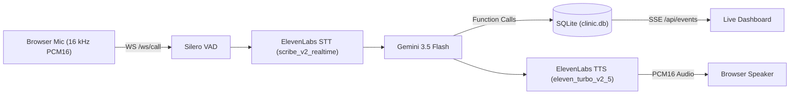
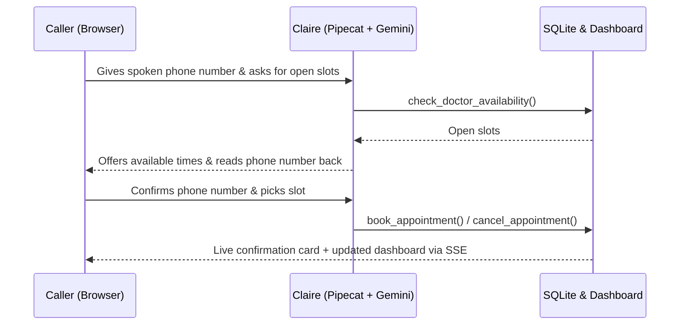

# Alderbrook Clinic — Voice Appointment Desk

Real-time clinic voice receptionist (**Claire**) paired with a live appointment dashboard. Callers speak directly from the browser—identified only by their spoken phone number—to check availability, book, and cancel appointments.

---

## Architecture



---

## Call Flow



---

## Stack

| Component | Model / Tool |
|---|---|
| **Pipeline** | Pipecat (`FastAPIWebsocketTransport` + `SileroVADAnalyzer`) |
| **Speech-to-Text** | ElevenLabs (`scribe_v2_realtime`) |
| **LLM** | **Google Gemini (`gemini-3.5-flash`)** |
| **Text-to-Speech** | ElevenLabs (`eleven_turbo_v2_5`) |
| **Backend & UI** | FastAPI, SQLite, SSE, Vanilla JS + Web Audio |

---

## Quick Start

```bash
git clone https://github.com/26Utkarsh/Alderbrook-AI-Reception.git
cd Alderbrook-AI-Reception

python -m venv .venv
# Windows: .\.venv\Scripts\Activate.ps1  |  macOS/Linux: source .venv/bin/activate

pip install -r requirements.txt
cp .env.example .env   # Add ELEVENLABS_API_KEY and GOOGLE_API_KEY

python run.py
```

Open **`http://localhost:8000`** and click **Try Call**.

## Tests

```bash
pytest -v
```
