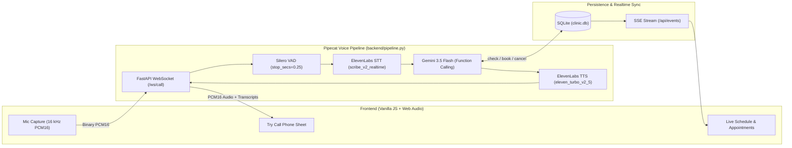
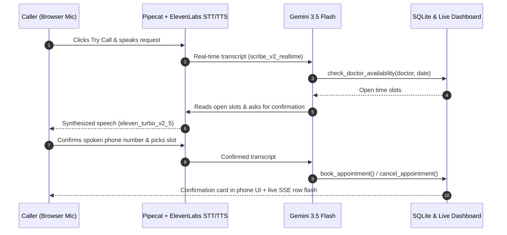

<div align="center">

# Alderbrook Clinic — Voice Appointment Desk

Real-time AI clinic receptionist (**Claire**) paired with a live reception dashboard.  
Identify callers by spoken phone number alone—check availability, book slots, and cancel appointments end to end.


</div>

---

## Architecture Graphic



---

## Call & Booking Workflow



---

## Tech Stack

| Layer | Technology | Model / Role |
|---|---|---|
| **Voice Framework** | Pipecat (`pipecat-ai`) | Pipeline orchestration, interruption handling, WebSocket transport |
| **Speech-to-Text** | ElevenLabs Realtime STT | `scribe_v2_realtime` with clinic `keyterms` & background noise filtering |
| **LLM** | **Google Gemini** | **`gemini-3.5-flash`** for dialogue & tool calling (`GEMINI_MODEL`) |
| **Text-to-Speech** | ElevenLabs TTS | `eleven_turbo_v2_5` streaming PCM16 audio (`EXAVITQu4vr4xnSDxMaL`) |
| **Turn Detection** | Silero VAD | Local voice activity detection (`stop_secs=0.25`) |
| **API & Storage** | FastAPI, Uvicorn, SQLite | REST, `/ws/call` WebSocket, `/api/events` SSE, `clinic.db` |
| **Frontend** | HTML, CSS, Vanilla JS | Web Audio resampling, reactive waveform, zero-build dashboard |

---

## Voice Tools & API

| Tool / Endpoint | Purpose | Key Behavior |
|---|---|---|
| `check_doctor_availability` | Query open doctor slots | Matches doctor name, specialty, or `YYYY-MM-DD` date |
| `book_appointment` | Reserve an open slot | Requires verbal phone confirmation; prevents double-booking |
| `cancel_appointment` | Cancel an active booking | Matches spoken phone number; frees slot & disambiguates duplicates |
| `GET /api/dashboard` | Initial UI state | Returns 4 seeded doctors with slots and appointments |
| `GET /api/events` | Real-time UI sync | SSE stream pushing `appointment_booked` & `appointment_cancelled` |
| `WS /ws/call` | Live voice session | Bidirectional 16 kHz PCM16 audio + JSON transcript/event frames |

---

## Clone Guide

```bash
git clone https://github.com/26Utkarsh/Alderbrook-AI-Reception.git
cd Alderbrook-AI-Reception
```

---

## Setup Guide

### 1. Create a Virtual Environment

| OS | Command |
|---|---|
| **Windows (PowerShell)** | `python -m venv .venv; .\.venv\Scripts\Activate.ps1` |
| **macOS / Linux** | `python3 -m venv .venv && source .venv/bin/activate` |

### 2. Install Dependencies

```bash
pip install -r requirements.txt
```

### 3. Configure Environment Variables

```bash
cp .env.example .env
```

Add your keys inside `.env` (never commit `.env`):

| Variable | Required | Default | Description |
|---|---|---|---|
| `ELEVENLABS_API_KEY` | Yes | — | ElevenLabs API key (STT + TTS) |
| `GOOGLE_API_KEY` | Yes | — | Google Gemini API key |
| `GEMINI_MODEL` | No | `gemini-3.5-flash` | Gemini model for reasoning & tools |
| `ELEVENLABS_VOICE_ID` | No | `EXAVITQu4vr4xnSDxMaL` | ElevenLabs voice ID for Claire |
| `PORT` | No | `8000` | FastAPI server port |

### 4. Run the App & Tests

```bash
# Run unit tests
pytest -v

# Start the server
python run.py
```

Open **`http://localhost:8000`**, allow microphone access, and click **Try Call**.
